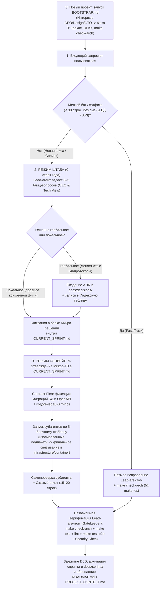

# Документационный фреймворк и методология разработки с AI-агентами (Agent Documentation Blueprint v3)

> Этот каталог содержит **готовую, проверенную на практике систему ведения документации и оркестрации AI-агентов** для любого программного проекта (SaaS, веб-сервисы, мобильные приложения, микросервисы).
>
> Система спроектирована так, чтобы человек (Tech Lead / Product Owner / CEO) и автономные AI-агенты работали как слаженная инженерная команда без галлюцинаций, потери контекста, свалки кода в одном пакете и архитектурного дрейфа.

---

## 💡 Философия подхода: «Документация как контекстная ОС проекта»

Главная проблема при работе с AI-агентами в коде — **потеря контекста**, **галлюцинации бизнес-логики** и **размывание архитектуры**.
Субагенты и новые сессии чата запускаются в изолированном контексте. Они не знают историю прошлых бесед, архитектурных договоренностей и локальных запретов.

В нашей системе документация — это **не пыльный архив**, а **активная операционная система**:
1. **Разделение принятия решений и реализации (Штаб vs Конвейер + Fast-Track)**: Агенты никогда не додумывают бизнес-логику на лету. Для новых фич в режиме «Штаб» (0 строк кода) через блиц-вопросы CEO/CTO принимаются продуктовые и технические решения, и только затем в режиме «Конвейер» пишется код. Для мелких багов и хотфиксов (< 30 строк) действует безбюрократичный режим **Fast-Track**.
2. **Единый источник правды и Индексная навигация**: Задачи текущего спринта живут строго в `CURRENT_SPRINT.md`, карта модулей — в `PROJECT_CONTEXT.md`, а для ADR и архива спринтов ведутся легкие **Индексные таблицы (Реестры)**, которые заменяют тяжелый векторный поиск и экономят до 90% токенов контекста.
3. **Защита от свалки кода и `make check-arch`**: Строгие лимиты (`< 300–400 строк` на файл и `<= 5–7 файлов` на пакет/папку с нарезкой на доменные подпакеты) проверяются автоматически скриптом `make check-arch`, который запускает как разработчик, так и главный агент-проверяющий (Gatekeeper).
4. **Contract-First, Design-First & Agent Continuity**: Контракты API (OpenAPI) и атомарный UI-Kit (`shared/components/ui/`) фиксируются до написания бизнес-фич, а субагенты переиспользуются между связанными задачами.

---

## 🛠️ Золотой стандарт технологического стека по умолчанию (Default Golden Stack)

Фреймворк спроектирован вокруг строгого, производительного и проверенного стека, оптимизированного под надежную работу автономных AI-субагентов без «галлюцинаций» и расползания зависимостей:

### 1. Серверная часть (Backend)
* **Язык и рантайм**: Go 1.23+
* **Архитектурный стиль**: Clean Architecture / DDD с жестким разделением на доменные подпакеты (`<= 5–7 файлов` в пакете, `< 300–400 строк` в файле).
* **Структура `backend/internal/` — строго 3 корневых подпакета**:
  - `domain/` — чистые бизнес-сущности, инварианты, доменные ошибки и события (0 внешних библиотек, никаких импортов SQL/HTTP).
  - `application/` — сценарии использования (Use Cases) и интерфейсы зависимостей (`ports.go`). Горизонтальные импорты между соседними `application/<pkg>` строго запрещены.
  - `infrastructure/` — ВСЕ технические адаптеры, включая точку сборки приложения (Composition Root):
    - `infrastructure/container/` (или `di/`) — инициализация репозиториев, сервисов и роутера (`main.go < 50 строк`).
    - `infrastructure/http/` — Echo роутер, middleware, обработчики.
    - `infrastructure/config/` — парсинг и валидация .env.
    - `infrastructure/db/` — подключение к БД, пул соединений, Context Transactor.
    - `infrastructure/repository/` — реализации репозиториев.
* **HTTP-фреймворк**: [Echo v4](https://echo.labstack.com/) (или Chi) — быстрый, легковесный, без лишней магии.
* **База данных и драйвер**: PostgreSQL 16+ с пулом соединений `pgxpool` (`github.com/jackc/pgx/v5`).
* **Генерация типов и SQL**: [sqlc](https://sqlc.dev/) — типобезопасный чистый SQL с генерацией Go-структур без медленных ORM.
* **Транзакции**: Context Transactor (управление транзакциями БД через `context.Context` без просачивания инфраструктурных типов в Use Cases).

### 2. Go CLI-инструменты (Установка строго через `go install`)
Все инструменты фиксируются с версиями и устанавливаются в `$HOME/go/bin`:
* **`mockery v3`**: `go install github.com/vektra/mockery/v3@latest` — генерация моков интерфейсов из `ports.go` для изолированного модульного тестирования.
* **`golang-migrate`**: `go install -tags 'postgres' github.com/golang-migrate/migrate/v4/cmd/migrate@latest` — воспроизводимые версионированные SQL-миграции.
* **`oapi-codegen v2`**: `go install github.com/oapi-codegen/oapi-codegen/v2/cmd/oapi-codegen@latest` — кодогенерация Go-сервера, типов и валидации по спецификации OpenAPI 3.0.
* **`sqlc`**: `go install github.com/sqlc-dev/sqlc/cmd/sqlc@latest` — компилятор SQL в типобезопасный Go-код.

### 3. Клиентская часть (Frontend)
* **Стек**: React 18/19, TypeScript, Vite.
* **Стилизация**: Tailwind CSS строго по **Дизайн-паспорту** (семантические токены в `tailwind.config.js`, строгий запрет на сырые цвета вроде `bg-blue-500` в бизнес-компонентах).
* **Управление состоянием**:
  - Серверное состояние (кэш, инвалидация, фоновые обновления): **TanStack Query v5** (`@tanstack/react-query`).
  - Клиентское UI-состояние (модалки, фильтры, локальные туглы): **Zustand**.
* **UI-компоненты**: Атомарный UI-Kit в `src/shared/components/ui/` (`Button`, `Input`, `Card`, `Modal`, `Badge`, `Skeleton`, `EmptyState`, `ErrorBanner`).
* **Иконки**: `lucide-react`.
* **Drag & Drop (при необходимости)**: `@dnd-kit/core` + `@dnd-kit/sortable`.

### 4. Контракты API (Contract-First)
* **OpenAPI 3.0**: Модульная мультифайловая спецификация в `api/openapi/*`.
* **Сборка бандла**: `@redocly/cli` (`npx @redocly/cli bundle api/openapi/openapi.yaml -o api/openapi.yaml`).
* **Двусторонняя генерация**: `oapi-codegen` для бэкенда и `openapi-typescript` для фронтенда.

### 5. Тестирование и Архитектурный контроль (QA & Governance)
* **E2E & Сквозное черное тестирование**: Python 3.12+ с ультрабыстрым менеджером окружений и рантаймом **`uv`** (`uv run pytest`) + `httpx`.
* **Unit-тесты Go**: `go test -v -race ./internal/...`.
* **Архитектурный линтер (`scripts/check_arch.sh` / `make check-arch`)**:
  1. Лимит размера файлов: `< 350–400 строк`.
  2. Лимит файлов в доменном подпакете: `<= 5–7 файлов`.
  3. Чистота слоя `domain`: 0 импортов SQL/HTTP/драйверов.
  4. Чистота дизайна: 0 сырых цветов Tailwind в `features/` и `widgets/`.
  5. Чистота `backend/internal/`: строго 3 корневых подпакета (`domain`, `application`, `infrastructure`).

### 6. Инфраструктура и Запуск
* **Контейнеризация**: Docker Compose (Postgres, Backend, Frontend, Nginx reverse proxy).
* **Единый фасад команд**: `Makefile` (`make up`, `make down`, `make test`, `make test-e2e`, `make check-arch`, `make migrate-up`, `make sqlc`, `make oapi`).

---

## 📁 Структура каталога и соответствие файлов в проекте

Для использования в новом проекте скопируйте файлы из этого шаблона в корень вашего репозитория:

```text
Ваш проект/
├── BOOTSTRAP.md                 # 🚀 Сценарий старта проекта с нуля (интервью CEO/CTO/Design Lead)
├── AGENTS.md                    # 🚩 Главная инструкция для всех AI-агентов (Шаг 0, Режимы работы, Fast-Track, Табу)
└── docs/
    ├── PROJECT_CONTEXT.md       # Архитектурный паспорт проекта, стек, сущности и Карта пакетов (Package Map)
    ├── CURRENT_SPRINT.md        # Текущий рабочий спринт (Штаб: микро-решения CEO/CTO + Конвейер: микро-ТЗ и DoD)
    ├── CONVENTIONS.md           # Указатель на инженерные конвенции
    ├── conventions/             # Инженерные конвенции: README.md, backend.md (Go, testify, mockery), frontend.md (UI-Kit, токены)
    ├── SUBAGENTS_GUIDE.md       # Регламент оркестрации: 4 архетипа, 5-блочный промпт, Blocker Protocol, формат отчета
    ├── ROADMAP.md               # Дорожная карта всех фаз проекта (начиная с Фазы 0)
    ├── decisions/               # Архитектурные решения (Architecture Decision Records, ADR)
    │   ├── README.md            # Инструкция + Индексный реестр всех ADR (читается в Шаге 0)
    │   └── template.md          # Шаблон создания нового ADR
    └── sprints/                 # Архив успешно завершенных спринтов
        ├── README.md            # Инструкция + Индексный реестр завершенных спринтов
        └── template.md          # Шаблон отчета о завершенном спринте
```

---

## 🗺️ Карта документации: Что где записывается?

| Файл / Каталог | Назначение | Кто читает | Кто обновляет | Частота обновления |
|---|---|---|---|---|
| **`BOOTSTRAP.md`** | Пошаговое интервью (CEO/Design/CTO) для генерации базовой документации на старте проекта и при пивотах. | Lead-агент на старте | Не требует обновления | При старте проекта / смене видения |
| **`AGENTS.md`** | Точка входа для AI. Оптимизированный Шаг 0, режимы «Штаб / Конвейер / Fast-Track», Blocker Protocol, табу. | Все AI-агенты в Шаге 0 | Tech Lead / Архитектор | Редко (при изменении глобальных правил) |
| **`docs/PROJECT_CONTEXT.md`** | Паспорт проекта: бизнес-модель, стек, ключевые сущности, RBAC, границы MVP и **Карта пакетов (Package Map)**. | Агенты, разработчики | Lead-агент / Tech Lead | При добавлении новых пакетов / сущностей |
| **`docs/CURRENT_SPRINT.md`** | Рабочий центр спринта: блиц-решения CEO/CTO, таблица задач, микро-ТЗ, DoD (включая безопасность и `make check-arch`). | Все агенты перед работой | Lead-агент, разработчики | Постоянно (по мере выполнения задач) |
| **`docs/conventions/`** | Инженерные конвенции: лимит строк (`<350–400`), лимит файлов в пакете (`<=7`), Clean Architecture, **Дизайн-паспорт**, тестирование (testify, mockery v3), безопасность, скрипт `make check-arch`. | Разработчики, субагенты | Lead Engineer / CTO | При добавлении конвенций и на старте проекта |
| **`docs/SUBAGENTS_GUIDE.md`** | Регламент оркестрации: 4 роли (`backend`, `frontend`, `qa`, `devops_security`), 5-блочный шаблон, правила параллельной работы, сжатый отчет. | Lead-агент (оркестратор) | Lead-агент | При добавлении новых архетипов субагентов |
| **`docs/ROADMAP.md`** | Высокоуровневая дорожная карта: Фазы 0..N, майлстоуны, прогресс по чекбоксам. | Product Owner, Lead | Lead-агент | В начале и конце каждого спринта |
| **`docs/decisions/` (ADR)** | Индексный реестр в `README.md` + файлы ключевых архитектурных развилок. | Вся команда (индекс — в Шаге 0) | Архитектор, Lead | При принятии глобальных технических решений |
| **`docs/sprints/`** | Индексный реестр в `README.md` + архивные отчеты закрытых спринтов с микро-решениями и метриками тестов. | Агенты (индекс — в Шаге 0) | Lead-агент | В момент завершения каждого спринта |

---

## 🔄 Жизненный цикл разработки (Штаб -> Конвейер + Fast-Track)



---

## 🚀 Быстрый старт

### Вариант А: Запуск совершенно нового проекта с нуля
1. Скопируйте файлы шаблона в пустой репозиторий.
2. Напишите агенту:
   > *"Привет! Прочитай `BOOTSTRAP.md`. Моя идея проекта: [описание]. Проведи меня по процессу инициализации."*

### Вариант Б: Подключение агента к уже настроенному проекту
1. В первом сообщении новой сессии чата напишите:
   > *"Привет! Мы работаем по правилам `AGENTS.md`. Выполни Шаг 0 и выведи текущий статус проекта из `CURRENT_SPRINT.md`."*
