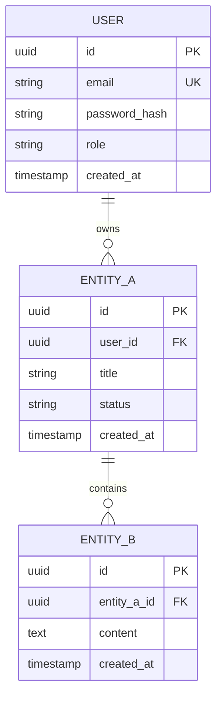

# Главный контекст проекта (`PROJECT_CONTEXT.md`)

> Этот документ — **архитектурный и продуктовый паспорт проекта**.
> Содержит глобальное видение, границы системы, стек технологий, базовые доменные модели и актуальную **Карту пакетов (Package Map)**.
> Читается каждым инженером и AI-агентом на «Шаге 0» перед погружением в кодовую базу.

---

## 🎯 1. Продуктовое видение и Бизнес-модель

* **Название проекта**: `[Название проекта]`
* **Миссия (Core Value Proposition)**: `[Одно-два предложения: какую ключевую боль пользователей решает продукт?]`
* **Целевая аудитория**: `[Кто конечные пользователи? B2B клиенты, B2C пользователи, внутренние операторы?]`
* **Главный пользовательский сценарий (Core Loop)**: `[Краткая цепочка: Пользователь делает А -> Система делает Б -> Пользователь получает ценность В]`
* **Формат продукта**: `[SaaS / Веб-приложение / Мобильное приложение / API-платформа]`
* **Бизнес-модель и монетизация**: `[Подписка / Разовые транзакции / Комиссия / Внутренний инструмент]`

---

## 🏛️ 2. Архитектурный стек и Технологии

| Слой | Технологии | Обоснование выбора |
|---|---|---|
| **Backend** | `[Например: Go 1.22+ (Chi / Echo) / Python (FastAPI)]` | `[Высокая производительность, строгая статическая типизация, простота поддержки субагентами]` |
| **Frontend** | `[Например: React 19, TypeScript, Vite, Tailwind CSS]` | `[Быстрый HMR, строгая типизация контрактов, компонентная дизайн-система]` |
| **База данных** | `[Например: PostgreSQL 16 + Миграции]` | `[Реляционная целостность, ACID транзакции, поддержка JSONB и UUID]` |
| **Кэш / Очереди / Лимиты** | `[Например: Valkey / Redis]` | `[Хранение сессий, кэширование, Token-Bucket Rate Limiting]` |
| **Файловое хранилище** | `[Например: S3 / MinIO]` | `[Изолированное объектное хранилище медиафайлов и документов]` |
| **Инфраструктура и Контроль** | `[Docker Compose, Nginx, Makefile, make check-arch]` | `[Dev/Prod parity в одну команду и автоматический контроль архитектуры]` |
| **Контракты API** | `[OpenAPI 3.0 мультифайловый (redocly bundle + oapi-codegen) / gRPC]` | `[Contract-First кодогенерация серверных интерфейсов и клиентских типов]` |
| **Тестирование & QA** | `[Python + uv (uv run pytest) + httpx, Go unit-тесты (-race)]` | `[Мгновенное развертывание сред через uv, сквозные E2E сценарии через HTTP API]` |
| **Go Tooling** | `[golang-migrate, mockery v3, oapi-codegen v2, sqlc через go install]` | `[Установка CLI-инструментов в $HOME/go/bin]` |

---

## 🧩 3. Доменная модель и Ключевые сущности



* **`User`**: Пользователь системы (аутентификация, профиль, глобальная роль).
* **`EntityA`**: `[Описание основной сущности 1: назначение, инварианты, права доступа, жизненный цикл]`.
* **`EntityB`**: `[Описание основной сущности 2: связь с сущностью 1, правила валидации]`.

---

## 👥 4. Ролевая модель и Безопасность (RBAC & Tenant Isolation)

* **`guest`**: Неавторизованный посетитель (доступ только к публичным эндпоинтам, лендингу и страницам аутентификации; жесткий Rate Limiting по IP).
* **`user`**: Стандартный авторизованный пользователь (строгий **Tenant Isolation** — доступ исключительно к записям, где `owner_id / tenant_id == current_user.id`).
* **`admin`**: Администратор системы (управление справочниками, модерация, просмотр системного аудита).

---

## 🛡️ 5. Архитектурные границы MVP (Scope Boundaries)

### Входит в текущую фазу (IN SCOPE):
- [ ] Инженерный каркас, скрипт архитектурного контроля `make check-arch` и базовый атомарный `UI-Kit`.
- [ ] Базовая регистрация и авторизация (JWT / Session + Refresh token, Rate Limiting).
- [ ] Основной CRUD и бизнес-сценарии для ключевых сущностей проекта.
- [ ] Адаптивный пользовательский интерфейс, построенный строго на компонентах дизайн-системы.
- [ ] 100% покрытие бизнес-логики модульными и сквозными E2E-тестами в Docker.

### Вынесено за рамки текущей фазы (OUT OF SCOPE):
- Сложные многопользовательские иерархии с кастомными матрицами прав (будущие фазы).
- Интеграции со второстепенными внешними провайдерами.
- Преждевременная микросервисная декомпозиция (на этапе MVP развиваем модульный монолит с четкими границами доменных подпакетов).

---

## 🗺️ 6. Карта пакетов и модулей (Package Map — Навигатор для агентов)

> **Правило для AI-агентов**: Перед созданием новой папки или пакета обязательно сверься с этой картой.
> Не создавай дублирующие пакеты с похожими названиями (например, `auth` и `authorization`). При добавлении нового доменного подпакета — добавь строку в эту таблицу. Лимит файлов (`<= 7 рабочих файлов в папке`) контролируется автоматически через `make check-arch`.

### Backend (`backend/internal/` — СТРОГО 3 корневых подпакета: domain, application, infrastructure)

| Слой / Подпакет | Путь | Назначение и зона ответственности |
|---|---|---|
| **Domain: Shared** | `internal/domain/shared` | Общие примитивы без внешних зависимостей (UUID, Money, Pagination, базовые коды ошибок). |
| **Domain: User** | `internal/domain/user` | Сущность `User`, роли, Value Objects (Email, PasswordHash), интерфейс репозитория. |
| **Domain: [FeatureA]** | `internal/domain/[feature_a]` | `[Сущности и бизнес-инварианты домена FeatureA]`. |
| **App: User** | `internal/application/user` | Сценарии регистрации, логина, профиля + `ports.go` (интерфейсы внешних зависимостей). |
| **App: [FeatureA]** | `internal/application/[feature_a]` | `[Use-cases домена FeatureA + ports.go]`. |
| **Infra: Container (DI)** | `internal/infrastructure/container` | Сборка зависимостей и роутинга (`repos.go`, `services.go`, `router.go`, `container.go`), чтобы `cmd/main.go` оставался компактным (< 50 строк). |
| **Infra: Config** | `internal/infrastructure/config` | Загрузка и валидация переменных окружения из .env. |
| **Infra: Postgres** | `internal/infrastructure/postgres/<pkg>` | Реализация репозиториев в подпакетах `userrepo`, `[feature_a]repo`. |
| **Infra: HTTP** | `internal/infrastructure/http/<pkg>` | HTTP-хендлеры, middleware (Auth, RateLimit, ErrorMapper) в подпакетах по доменам. |

### Frontend (`frontend/src/`)

| Модуль / Фича | Путь | Назначение и зона ответственности |
|---|---|---|
| **Shared UI-Kit** | `src/shared/components/ui` | Атомарные примитивы дизайн-системы (`Button`, `Input`, `Card`, `Modal`, `Skeleton`, `EmptyState`, `ErrorBanner`). |
| **Feature: Auth** | `src/features/auth` | Формы входа/регистрации, хук `useAuth`, защита роутов. |
| **Feature: [FeatureA]** | `src/features/[feature_a]` | `[Компоненты, хуки и представления фичи FeatureA]`. |
| **API Client** | `src/api` | Автосгенерированные типы и клиентские методы по контракту OpenAPI. |

---

## 📂 7. Общая структура монорепозитория

```text
корень_проекта/
├── BOOTSTRAP.md             # Сценарий инициализации и пивотов проекта
├── AGENTS.md                # Главная инструкция для AI-агентов
├── Makefile                 # Команды сборки, тестов и архитектурного контроля (make check-arch)
├── scripts/
│   └── check_arch.sh        # Автоматический линтер длины файлов, размера пакетов и слоев DDD
├── backend/                 # Серверная часть (Clean Architecture / DDD с доменными подпакетами)
│   ├── cmd/                 # Тонкая точка входа (main.go < 50 строк)
│   ├── internal/
│   │   ├── domain/          # Изолированные доменные подпакеты (domain/<pkg>)
│   │   ├── application/     # Изолированные подпакеты сценариев (application/<pkg> + ports.go)
│   │   └── infrastructure/  # Адаптеры БД, HTTP и Composition Root (infrastructure/container/)
│   ├── api/openapi/         # Спецификация контрактов (api.yaml)
│   └── migrations/          # SQL миграции базы данных (up/down)
├── frontend/                # Клиентская часть (React + TypeScript + Tailwind)
│   ├── src/app/             # Роутер и глобальные провайдеры
│   ├── src/pages/           # Тонкие страницы-контейнеры
│   ├── src/features/        # Доменные фичи (components, hooks, types)
│   ├── src/shared/          # Атомарный UI-Kit (components/ui/), общие хуки и утилиты
│   └── src/api/             # Типизированный API-клиент
├── deploy/                  # Конфигурации Docker, Nginx, Compose
├── tests/                   # Изолированные сквозные E2E-тесты (Docker-ready)
└── docs/                    # Полная база знаний проекта (CURRENT_SPRINT, CONVENTIONS, ADR, sprints)
```

---

*Последнее обновление: `[ГГГГ-ММ-ДД]`*
