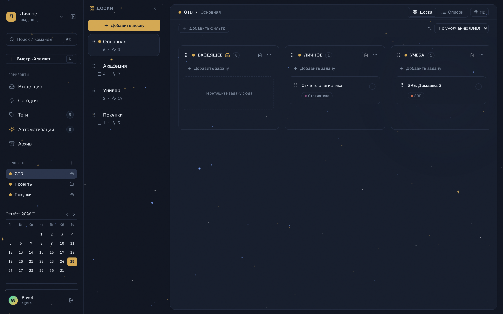
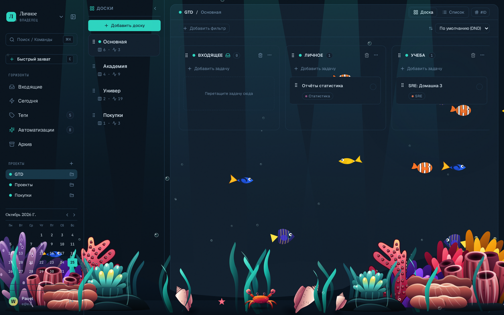
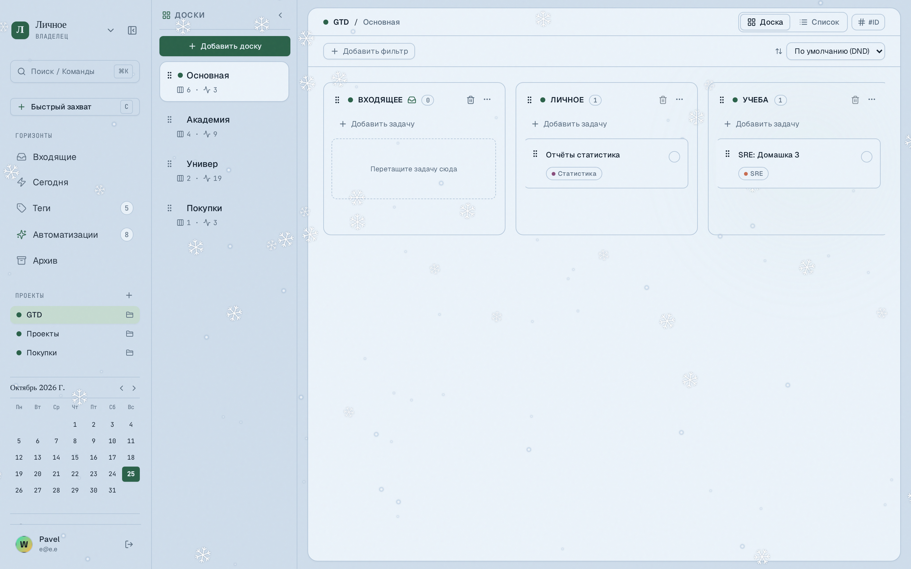
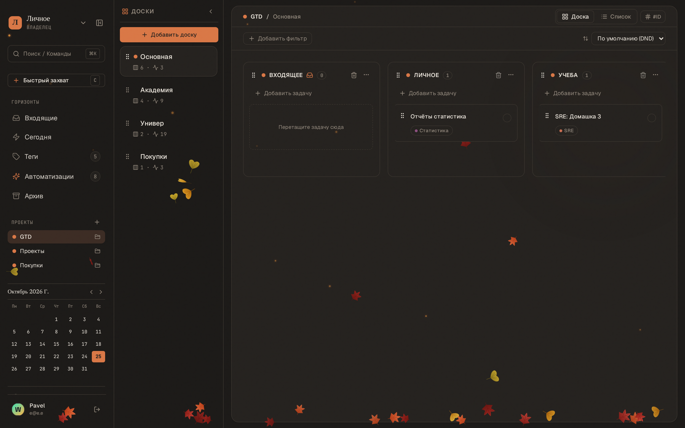
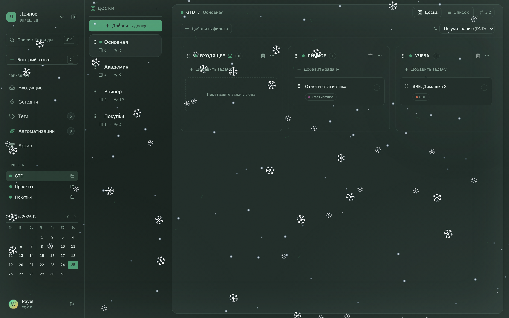
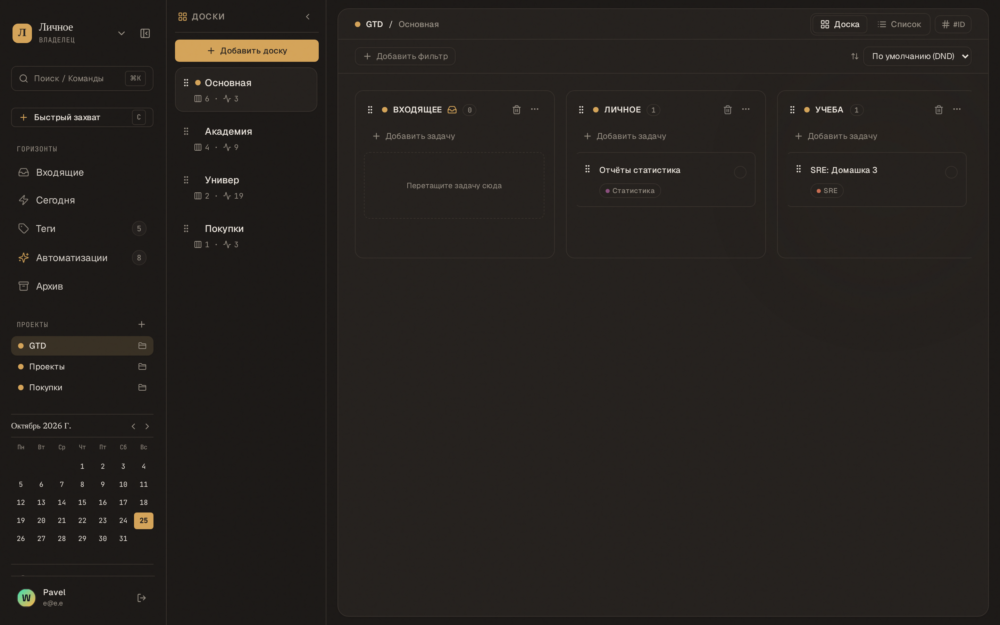

# Takt

Minimal task manager built around focus, automations, and keyboard-first navigation.

[](https://go.dev/)
[](https://react.dev/)
[](https://www.typescriptlang.org/)
[](https://www.postgresql.org/)
[](LICENSE)

---


---

## Features

- **Kanban + Focus view** — Multiple boards per project, fractional indexing reordering, daily "Today" horizon, and rapid inbox triage (`C`).
- **Low-code automations** — Event-driven "WHEN → IF → THEN" rule engine with column triggers, multi-step actions, and recursive loop protection.
- **Activity history & audit** — Granular per-task audit trail attributing actions to specific users or automation rules (`#A-XXXX`).
- **Ambient visual themes** — 17 crafted palettes (light washi paper, evening brass, and live animated atmospheres with zero-overhead particle physics).
- **Keyboard-first navigation** — Full keyboard traversal (`J`/`K`), quick capture (`C`), command palette (`⌘K`), and instant side drawer (`?task=:id`).
- **Self-hosted & private** — Single Docker Compose stack with PostgreSQL and S3-compatible object storage (MinIO).

---

## Core Views

| Task Inspector & Activity Audit | Automation Rule Builder |
|:---:|:---:|
|  |  |
| **Task Inspector:** Markdown notes, subtasks checklist, attachments, and granular activity history with actor attribution. | **Low-Code Rule Builder:** Declarative condition and action chaining, column-level scopes, and automated execution. |

| Today Focus Horizon | Washi Paper Kanban |
|:---:|:---:|
|  |  |
| **Daily Focus (GTD):** Isolate 3–5 high-impact tasks for the day without getting lost in backlogs. | **Distraction-Free Canvas:** Calm typography, pastel tag tokens, and smooth drag-and-drop. |

---

## Ambient Themes Gallery

Takt features **17 curated palettes** designed for extended focus sessions without visual fatigue. Dynamic themes run GPU-accelerated particle simulations on HTML5 canvas with zero React re-renders and minimal energy impact.

| Celestial Atlas | Deep Ocean |
|:---:|:---:|
|  |  |
| Interactive starfield, pulsing constellations & astrolabe lines | Deep sapphire waters, shimmering caustic light rays & marine life |

| Winter Snow | Autumn Fall |
|:---:|:---:|
|  |  |
| Gentle crystalline snowfall on icy paper with parallax depth | Drift of autumn foliage and interactive leaf whirlwind |

| Frost Pine | Evening Espresso |
|:---:|:---:|
|  |  |
| Nighttime evergreen blizzard with frosted vignettes | Matte brass, roasted walnut, and warm dark typography |

---

## Tech Stack

- **Backend:** Go 1.23 · Echo · sqlc · pgx · OpenAPI 3.1
- **Frontend:** React 18 · TypeScript · Vite · Tailwind CSS · TanStack Query · dnd-kit
- **Storage:** PostgreSQL 16 · MinIO (S3-compatible attachment storage)
- **Infrastructure:** Docker Compose · Nginx · golang-migrate

---

## Self-Hosting

### Using Docker Compose

1. Clone the repository:
   ```bash
   git clone https://github.com/c4erries/takt.git
   cd takt
   ```

2. Start all services:
   ```bash
   docker compose up -d --build
   ```

3. Open the application:
   - Web UI: [http://localhost:5173](http://localhost:5173) (or [http://localhost:80](http://localhost:80) via Nginx)
   - API Health: [http://localhost:8080/api/health](http://localhost:8080/api/health)

---

## Development

### Prerequisites

- Go 1.23+
- Node.js 20+
- PostgreSQL 16 & MinIO (or run `docker compose up -d postgres minio`)

### Running Locally

```bash
# 1. Start backing services
docker compose up -d postgres minio

# 2. Run backend
cd backend
go run ./cmd/server

# 3. Run frontend (in another terminal)
cd frontend
npm install
npm run dev
```

### Verification & Quality Gates

```bash
# Architecture checks (file size limits, package bounds, color tokens)
make check-arch

# Backend unit & integration tests
make test

# Frontend lint & production build
cd frontend && npm run lint && npm run build
```

---

## Documentation

- [Project Context & Package Map](docs/PROJECT_CONTEXT.md)
- [Engineering Conventions](docs/conventions/README.md)
- [Architecture Decision Records (ADRs)](docs/decisions/README.md)
- [Sprint History & Roadmap](docs/sprints/README.md)

---

## License

[MIT](LICENSE)
