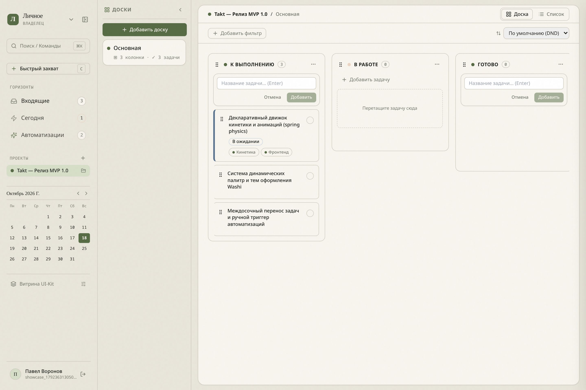
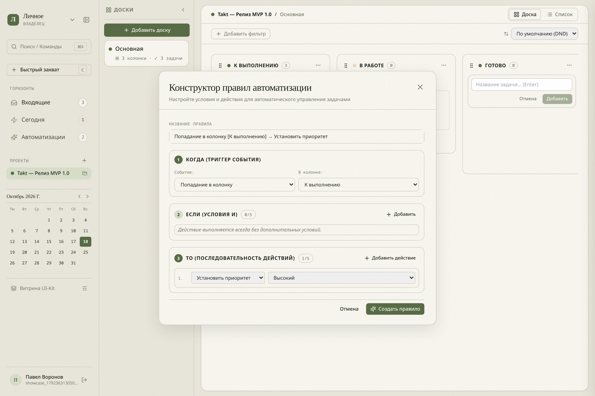
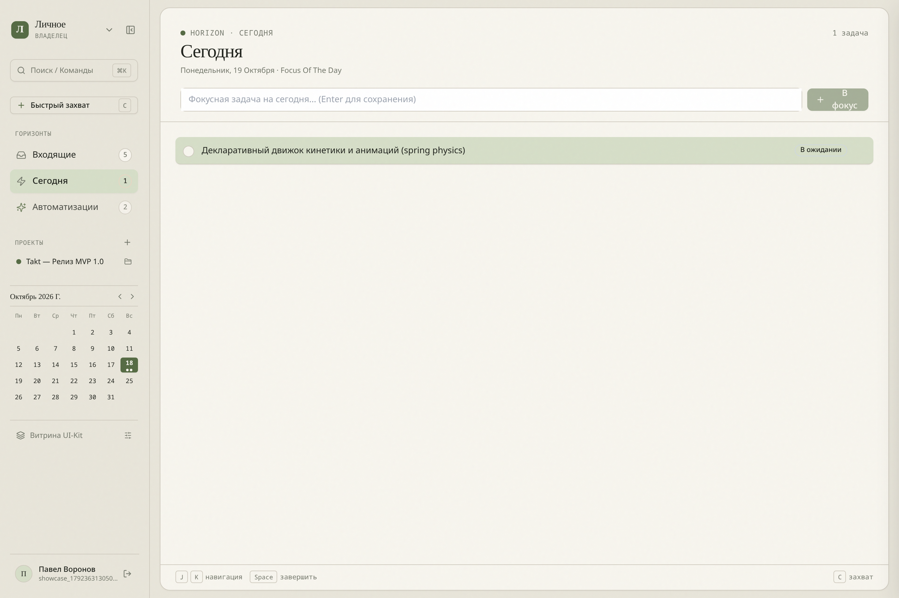

# 🎋 Takt

> **Скоростной таск-трекер и GTD-воркспейс с канбан-досками и low-code автоматизациями.**  
> Спроектирован на стыке клавиатурной скорости (*Superhuman / Linear*), визуальных досок (*WEEEK*) и спокойной эстетики японской канцелярии (*Midori MD / Hobonichi*).

[](https://go.dev/)
[](https://react.dev/)
[](https://www.typescriptlang.org/)
[](https://www.postgresql.org/)
[](LICENSE)

---



---

## 💡 О проекте

Большинство таск-трекеров скатываются в одну из двух крайностей: либо перегруженные корпоративные монстры с бесконечными выпадающими списками, либо сверхминималистичные plain-text списки без наглядного пайплайна движения задач.

**Takt** объединяет оба подхода:
1. **Быстрый захват и разбор**: Мгновенный сброс мыслей во «Входящие» (`C`), J/K-навигация без мыши и ежедневный горизонт «Сегодня».
2. **Визуальный канбан-пайплайн**: Мульти-доски в проектах, плавный Drag-and-Drop с fractional indexing и навигационная панель досок.
3. **Low-Code автоматизации**: Фоновый движок правил «КОГДА $\rightarrow$ ЕСЛИ $\rightarrow$ ТО», избавляющий от ручного перекладывания карточек и смены статусов.
4. **Анти-шум интерфейс**: Никаких кислотных баннеров и навязчивых уведомлений — палитра японской бумаги Washi (`#F7F5EE`), акцент чая матча (`#566B44`) и книжная антиква Newsreader.

---

## 🌟 Ключевые возможности

### 1. Канбан-доски и мульти-навигация
* **Мульти-доски в проектах**: Каждая инициатива может содержать несколько независимых досок (например, *Бэкенд*, *Фронтенд*, *Маркетинг*).
* **Суб-навигационный рейл (Boards Rail)**: Компактная боковая панель с быстрым переключением между досками, счетчиками задач и возможностью сворачивания в 1 клик.
* **Fractional Indexing**: Мгновенная сортировка колонок и карточек с вычислением промежуточных позиций без массовых блокировок базы данных.
* **Скролл колесиком мыши (Middle-Click Pan)**: Зажмите колесико мыши в любой точке полотна для плавного перемещения по широким доскам.
* **Динамические фильтры**: Фильтрация задач по приоритетам, срокам и тегам с мгновенным откликом без перезагрузки страницы.

---

### 2. Инспектор задач (Task Drawer)


* **Мгновенный слайд-овер (560px)**: Открывается сбоку без потери контекста доски. Синхронизируется с адресной строкой (`?task=:id`) — ссылкой на задачу можно делиться напрямую.
* **Пастельная палитра тегов**: Система меток с автодополнением и мягкими токенами без режущих глаз цветов и лишних символов (`#`).
* **Контекстные приоритеты**: `Обычный`, `Низкий`, `Средний`, `Высокий`, `В ожидании` — активные бейджи окрашиваются в семантический цвет приоритета.
* **Заметки в Markdown**: Встроенный редактор заметок с поддержкой списков, чекбоксов и кода.
* **Фокус дня в 1 клик**: Кнопка «В фокус дня» сразу выводит задачу в ежедневный горизонт «Сегодня».

---

### 3. Визуальный Low-Code конструктор правил



* **Sentence Builder «КОГДА $\rightarrow$ ЕСЛИ $\rightarrow$ ТО»**: Понятная декларативная модель сборки автоматизаций.
* **Триггеры**: Попадание задачи в колонку, завершение задачи, изменение полей, SLA-таймеры нахождения в колонке, периодические проверки.
* **Гибкие условия**: Логические цепочки `AND` / `OR`, предикатные операторы (`равно`, `содержит`, `дедлайн просрочен`, `в пределах N дней`).
* **Действия**: Смена колонки, выставление приоритета, навешивание/снятие тегов, авто-архивация, назначение сроков.
* **Защита от зацикливания**: Движок событий отслеживает цепочки вызовов и предотвращает бесконечные рекурсивные петли.
* **Колоночные пресеты**: Быстрое подключение автоматизаций напрямую из контекстного меню колонки (`...`).

---

### 4. Горизонт «Сегодня» и GTD-ритуал



* **Четкое разделение горизонтов**:
  * `Входящие` (Inbox) — свалка входящих мыслей и неотсортированных задач.
  * `Сегодня` (Today) — 3–5 ключевых фокусных задач на текущий день.
  * `Проекты` (Projects) — структурированные канбан-пайплайны.
* **Клавиатурная скорость**:
  * `C` — Быстрый захват задачи (Quick Capture) из любой точки приложения.
  * `J` / `K` — Перемещение по списку задач вверх/вниз.
  * `Space` — Завершение / снятие задачи.
  * `⌘K` / `Ctrl+K` — Командная палитра для поиска задач, проектов и действий.
  * `[` — Быстрое сворачивание/разворачивание левого сайдбара.

---

## 🏗️ Архитектура и Инженерные стандарты

Проект построен по принципам **Clean Architecture** и строгой модульности с автоматическим контролем целостности.

```
takt/
├── api/openapi/               # Контракты OpenAPI 3.0 (Contract-First)
│   ├── paths/                 # REST-эндпоинты
│   └── schemas/               # DTO-схемы данных
├── backend/                   # Бэкенд на Go 1.23+
│   ├── cmd/server/            # Тонкая точка входа (< 50 строк)
│   ├── internal/
│   │   ├── domain/            # Чистый домен: сущности, инварианты, ошибки
│   │   │   ├── task/
│   │   │   ├── project/
│   │   │   └── automation/
│   │   ├── application/       # Use Cases, оркестрация транзакций, порты
│   │   └── infrastructure/    # Реализации: Echo HTTP, pgx/sqlc, EventBus, Container
│   ├── migrations/            # SQL-миграции (golang-migrate)
│   └── queries/               # Исходные SQL-запросы для sqlc
├── frontend/                  # Клиент на React 19 + TypeScript + Vite
│   └── src/
│       ├── app/               # Composition root, провайдеры
│       ├── entities/          # TanStack Query модели (task, project, automation)
│       ├── features/          # Изолированные фичи (kanban-board, automations, board-filters)
│       ├── widgets/           # Композитные блоки (sidebar, main-sheet, task-drawer)
│       └── shared/            # Дизайн-система Washi (Button, Badge, Input, Modal)
└── docs/                      # Архитектурный паспорт, ADR и спецификации спринтов
```

### Ключевые технические решения:
* **Contract-First API**: Любое изменение API начинается со спецификации OpenAPI 3.0 (`api/openapi/*`). Из неё через `oapi-codegen` генерируются серверные интерфейсы и TypeScript-типы.
* **100% типобезопасный SQL**: Никаких тяжелых ORM. `sqlc` компилирует чистые PostgreSQL-запросы в производительный Go-код.
* **Архитектурный гейткипер (`make check-arch`)**: Автоматический линтер, встроенный в CI/CD:
  * Не более 350–400 строк в файле.
  * Не более 5–7 файлов в одном пакете/модуле.
  * Запрет прямых циклических импортов между доменными модулями.
  * Запрет использования сырых цветов в коде UI (только семантические токены Washi/Matcha).

---

## 🚀 Быстрый старт

### Требования
* **Docker** и **Docker Compose**
* **Make**

### Запуск через Docker Compose (рекомендуется)

```bash
# Клонирование репозитория
git clone https://github.com/c4erries/takt.git
cd takt

# Запуск всего стека (PostgreSQL 16 + Backend API + Frontend SPA + Nginx)
docker compose up -d --build
```

Приложение будет доступно по адресу:
* **Веб-интерфейс**: `http://localhost:5173` (или `http://localhost:80` при запуске через Nginx)
* **Backend API Health**: `http://localhost:8080/api/health`
* **PostgreSQL**: `localhost:5432` (`takt_user` / `takt_password`, база `takt_db`)

---

### Локальная разработка (без Docker для сервисов приложения)

1. **Поднимите базу данных**:
   ```bash
   docker compose up -d postgres
   ```

2. **Запустите бэкенд**:
   ```bash
   cd backend
   go run cmd/server/main.go
   ```

3. **Запустите фронтенд**:
   ```bash
   cd frontend
   npm install
   npm run dev
   ```

---

## 🛠️ Основные команды разработки

Все рутинные операции автоматизированы через корневой `Makefile`:

```bash
# Проверка архитектурных лимитов и дизайн-паспорта
make check-arch

# Запуск модульных тестов бэкенда (с race detector)
make test

# Запуск E2E-тестов (Python/pytest)
make test-e2e

# Полная кодогенерация (OpenAPI -> Go & TS, sqlc -> Go)
make generate

# Применение миграций БД
make migrate-up
```

---

## 📚 Документация проекта

Подробная документация и история архитектурных решений находятся в каталоге `docs/`:

* 🎯 **[PROJECT_CONTEXT.md](docs/PROJECT_CONTEXT.md)** — Продуктовый паспорт, ER-диаграмма сущностей и актуальная Карта Пакетов (Package Map).
* 📐 **[Инженерные конвенции](docs/conventions/README.md)** — [Backend-конвенции](docs/conventions/backend.md) и [Frontend-конвенции](docs/conventions/frontend.md).
* 🏛️ **[Реестр архитектурных решений (ADR)](docs/decisions/README.md)** — Журнал ключевых архитектурных выборов:
  * [ADR-0001: Архитектурный стек и Clean Architecture](docs/decisions/0001-initial-architecture-and-stack.md)
  * [ADR-0004: Движок Low-Code автоматизаций и DSL](docs/decisions/0004-low-code-automations-dsl.md)
* 🗺️ **[ROADMAP.md](docs/ROADMAP.md)** — Стратегический план развития проекта по фазам (до MVP 1.0 и далее).
* ⚡ **[CURRENT_SPRINT.md](docs/CURRENT_SPRINT.md)** — Оперативный статус текущего спринта разработки.
* 🧭 **[AGENTS.md](AGENTS.md)** — Регламент и системный протокол работы AI-агентов.

---

## 📄 Лицензия

Проект распространяется под лицензией [MIT](LICENSE).
