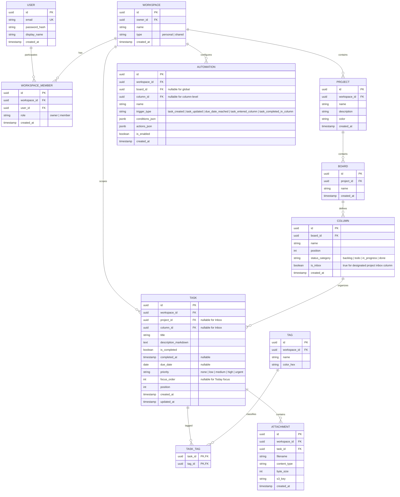

# Главный контекст проекта (`PROJECT_CONTEXT.md`)

> Этот документ — **архитектурный и продуктовый паспорт проекта Takt**.
> Содержит глобальное видение, границы системы, стек технологий, базовые доменные модели и актуальную **Карту пакетов (Package Map)**.
> Читается каждым инженером и AI-агентом на «Шаге 0» перед погружением в кодовую базу.

---

## 🎯 1. Продуктовое видение и Бизнес-модель

* **Название проекта**: **Takt**
* **Миссия (Core Value Proposition)**: Скоростной таск-трекер и персональная система продуктивности с канбан-досками и списками задач в эстетике *Editorial Tech / Humanist Minimalism*, где рутинные действия и перемещения задач автоматически выполняются декларативным фоновым движком автоматизаций (Workflow Automation Engine).
* **Целевая аудитория**: Знающие цену времени специалисты, разработчики, фаундеры и творческие профессионалы, которым нужен быстрый, тактильный инструмент для личного планирования и управления проектными задачами без корпоративной перегруженности.
* **Главный пользовательский сценарий (Core Loop)**:
  1. **Quick Capture**: Мгновенный сброс входящих мыслей и задач во «Входящие» (Inbox) в 1 клик или по горячей клавише без обязательного заполнения полей.
  2. **Organize**: Разбор Inbox по проектам/доскам или датам (в виде Канбан-доски или плоского Списка).
  3. **Focus of the Day & Engage**: Фокусный список задач на сегодня с J/K клавиатурной навигацией и тайм-слотами.
  4. **Workflow Automation**: Автоматические правила (Done $\rightarrow$ автоперенос в архив, дата сегодня $\rightarrow$ фокус, привязка проекта $\rightarrow$ выход из Inbox) снимают рутину перекладывания карточек.
* **Формат продукта**: Web SPA / PWA (адаптивный десктопный и мобильный интерфейс, оптимизированный под тактильное ощущение дорогой японской канцелярии и книг).
* **Бизнес-модель и монетизация**: Personal-First бесплатное ядро для индивидуальной работы + командные рабочие пространства (Shared Workspaces) с расширенным лимитом автоматизаций и совместной работы.

---

## 🏛️ 2. Архитектурный стек и Технологии

| Слой | Технологии | Обоснование выбора |
|---|---|---|
| **Backend** | **Go 1.23+**, роутер **Echo v4** | Высокая производительность, статическая типизация, надёжная middleware-система, скорость работы AI-агентов с чистым Go. |
| **База данных & SQL** | **PostgreSQL 16**, драйвер **pgx/v5** + **sqlc** | ACID-транзакции, хранение JSONB-правил автоматизаций; `sqlc` компилирует чистый `.sql` в 100% типобезопасный Go-код без медленных ORM и runtime-ошибок. |
| **Транзакции** | Unit of Work / **Transactor** через `context.Context` | Чистая передача контекстной транзакции `pgx.Tx` в `sqlc` (`q.WithTx(tx)`) на уровне application use-cases. |
| **События домена** | Асинхронный **`EventBus`** (in-memory воркеры в v1) | Развязка доменных действий (`TaskCompleted`, `TaskMoved`) от исполнения автоматизаций; готов к прозрачной замене на Kafka / Redis Streams в v2. |
| **Frontend** | **React 18/19**, **TypeScript**, **Vite**, **Tailwind CSS** | Быстрый DX/HMR, строгая типизация DTO, гибкая компонентная вёрстка по дизайн-токенам. |
| **Шрифты & Дизайн** | **Newsreader** (Google Fonts Serif) + **Geist Sans** (UI) + **JetBrains Mono** | Контраст книжной антиквы для разделов, плотного гротеска для текста задач и моноширинного шрифта для цифр/шорткатов. |
| **Управление состоянием** | **TanStack Query (React Query)** + **Zustand** | React Query для синхронизации с сервером и оптимистичных апдейтов; Zustand для локального UI (фокусная строка, инспектор, меню). |
| **Drag & Drop & Иконки** | **`@dnd-kit/core`**, **`lucide-react`** (stroke 1.5px) | Доступный легкий DnD для канбан-колонок; строгие контурные иконки без визуального мусора. |
| **Анимации & Кинетика** | **`motion` (`motion/react` v12+)** | Пружинная физика (`spring physics`), `AnimatePresence`, layout-переходы, A11y Dampening (`prefers-reduced-motion`). |
| **Контракты API** | **OpenAPI 3.0** (мультифайловый: `api/openapi/*`) | Модульная спецификация (paths/schemas), склейка через `@redocly/cli`, генерация серверных роутов через `oapi-codegen`. |
| **Инфраструктура** | **Docker Compose**, **Nginx** (reverse proxy), **Makefile** | Локальный и продакшн паритет; Nginx маршрутизирует `/api/*` в Go и отдает фронтенд; `make check-arch` линтит архитектуру. |
| **Тестирование & Python** | **uv** + **pytest** + **httpx** (`tests/`) | Ультрабыстрый запуск (`uv run pytest`), изоляция виртуального окружения, E2E проверка пользовательских сценариев через HTTP API. |
| **Go Tooling** | `golang-migrate`, `mockery v2/v3`, `oapi-codegen` | Установка инструментов строго через `go install` в `$HOME/go/bin`. |
| **Объектное хранилище (Фаза 3)** | **S3-совместимое хранилище** (MinIO в Docker Compose, AWS S3 / Cloudflare R2 / Ceph в prod) | Хранение изображений, вложений к задачам, аватарок; адаптер `internal/infrastructure/storage/s3` на базе `aws-sdk-go-v2` с presigned URLs. |

---

## 🧩 3. Доменная модель и Ключевые сущности



### Назначение ключевых сущностей:
* **`User`**: Пользователь сервиса (аутентификация, профиль).
* **`Workspace`**: Контейнер изоляции данных (Tenant). По умолчанию при регистрации создается `personal` воркспейс, не требующий настройки. Дополнительно можно создать `shared` воркспейс.
* **`Project` & `Board` & `Column`**: Пространства задач. Колонка определяет статус задачи и порядок сортировки на Канбан-доске.
* **`Task`**: Центральная единица работы. Если `project_id` и `column_id` не заданы — задача находится во **«Входящих» (Inbox)**. Если задан `focus_order` или `due_date = current_date`, задача всплывает в виде **«Сегодня» (Focus of the Day)**.
* **`Automation`**: Декларативное правило автоматизации. В v1 активируется тумблерами готовых шаблонов, в v2 расширяется до кастомного конструктора/скриптов.

---

## 👥 4. Ролевая модель и Безопасность (RBAC & Tenant Isolation)

* **Personal Workspace**:
  - Единственный владелец (**`Owner`**). Полная изоляция: все запросы жестко фильтруются по `workspace_id` текущей сессии пользователя.
* **Shared Workspace**:
  - **`Owner`**: Полный контроль (настройки воркспейса, удаление проектов, управление участниками, переключение автоматизаций).
  - **`Member`**: Создание, редактирование, перемещение и закрытие задач, работа с досками и списками.
* **Tenant Isolation**: Все таблицы (`tasks`, `projects`, `automations`) содержат `workspace_id`. Ни один SQL-запрос не исполняется без проверки членства пользователя в запрашиваемом воркспейсе.

---

## 🛡️ 5. Архитектурные границы MVP (Scope Boundaries)

### Входит в Core MVP v1 (IN SCOPE):
- [x] Инженерный каркас монорепозитория, скрипт `scripts/check_arch.sh` и команда `make check-arch`.
- [x] Базовый атомарный UI-Kit в стиле **Editorial Tech / Japanese Stationery** (`#E8E5DA` Canvas, `#F7F5EE` Washi, круговой чекбокс 18px, бейджи, кнопки, инпуты).
- [x] Регистрация и вход (Email + Password, JWT в HTTP-only cookies / Header), автоматическое создание Personal Workspace.
- [x] Быстрый захват задач в **Inbox** (Quick Capture).
- [x] Проекты, Канбан-доска (drag-and-drop колонок и карточек) и вид плоского Списка (List view).
- [x] Вид **«Сегодня / Focus of the Day»** с пружинной J/K навигацией клавиатуры.
- [x] Декларативный движок автоматизаций (EventBus + Rule Evaluator) с 3 готовыми правилами-тумблерами:
  1. *Inbox Zero*: Задаче назначен проект или срок $\rightarrow$ автоперемещение из Inbox.
  2. *Done & Archive*: Чекбокс отмечен $\rightarrow$ автоперенос в колонку «Done» с фиксацией `completed_at`.
  3. *Auto-Focus*: Срок задачи наступил «Сегодня» $\rightarrow$ автоперевод в активный статус / фокус.
- [x] E2E тест-сьют на Python (`pytest` + `httpx`) в `tests/` (25/25 PASS).

### Вынесено за рамки v1 (OUT OF SCOPE, отложено на v2+):
- Визуальный no-code / low-code конструктор произвольных правил автоматизаций (отложено на v2).
- Внешняя синхронизация с Google Calendar / Apple Calendar.
- Сложные правила рекуррентных задач (Recurrence: повторять каждый понедельник).
- Нативные мобильные приложения (v1 — отзывчивый PWA для десктопа и смартфонов).
- Биллинг, платные тарифные планы и лимиты.

---

## 🗺️ 6. Карта пакетов и модулей (Package Map — Навигатор для агентов)

> **Правило для AI-агентов**: Перед созданием новой папки или файла обязательно сверься с этой картой.
> Лимит: не более **5–7 рабочих файлов в папке**, размер файла **< 350–400 строк**.

### Backend (`backend/internal/` — СТРОГО 3 корневых подпакета: domain, application, infrastructure)

| Слой / Подпакет | Путь | Назначение и зона ответственности |
|---|---|---|
| **Domain: Shared** | `internal/domain/shared` | Базовые типы (ID, Pagination, системные доменные ошибки). |
| **Domain: Workspace** | `internal/domain/workspace` | Модель Workspace, WorkspaceMember, роли и инварианты. |
| **Domain: Project** | `internal/domain/project` | Модели Project, Board, Column, порядок и статусы. |
| **Domain: Task** | `internal/domain/task` | Модели Task, Tag, чекбокс выполнения, приоритеты, фокус. |
| **Domain: Attachment** | `internal/domain/attachment` | Модель Attachment, валидация типов, лимитов размера и санитайзинг имен файлов. |
| **Domain: Automation** | `internal/domain/automation` | Модель Automation, Rule Evaluator, типы триггеров и действий. |
| **Domain: Events** | `internal/domain/events` | Доменные события (`TaskCreated`, `TaskMoved`, `TaskCompleted`) и интерфейс `EventBus`. |
| **App: Workspace** | `internal/application/workspace` | Сценарии создания воркспейса, приглашений + `ports.go`. |
| **App: Project** | `internal/application/project` | Сценарии управления проектами, досками и колонками + `ports.go`. |
| **App: Task** | `internal/application/task` | Сценарии создания задач (Inbox capture), перемещения, отметки Done + `ports.go`. |
| **App: Attachment** | `internal/application/attachment` | Сценарии загрузки, получения контента, списка и удаления вложений + `ports.go`. |
| **App: Search** | `internal/application/search` | Сценарии полнотекстового сквозного поиска по задачам и проектам + `ports.go`. |
| **App: Automation** | `internal/application/automation` | Подписка на события домена, вычисление условий и исполнение действий + `ports.go`. |
| **Infra: Container (DI)** | `internal/infrastructure/container` | Сборка сервисов, репозиториев и роутинга Echo (`repos.go`, `services.go`, `router.go`, `container.go`). `main.go < 50 строк`. |
| **Infra: Config** | `internal/infrastructure/config` | Загрузка и валидация переменных окружения из .env (`config.go`). |
| **Infra: HTTP** | `internal/infrastructure/http` | Роутер Echo, хендлеры API (по OpenAPI), middleware (Auth, Tenant, ErrorMapper). |
| **Infra: DB** | `internal/infrastructure/db` | Инициализация `pgxpool`, Unit of Work / Transactor через `context.Context`, сгенерированный `sqlc`-код. |
| **Infra: Storage (S3)** | `internal/infrastructure/storage/s3` | Адаптер S3/MinIO на базе AWS SDK v2 (`PutObject`, `GetObject`, `DeleteObject`). |
| **Infra: EventBus** | `internal/infrastructure/eventbus` | In-memory диспетчер доменных событий с пулом горутин (задел под Kafka). |
| **Infra: Repositories** | `internal/infrastructure/repository` | Реализация интерфейсов хранения на базе `sqlc` по подпакетам. |

### Frontend (`frontend/src/`)

| Модуль / Фича | Путь | Назначение и зона ответственности |
|---|---|---|
| **App** | `src/app` | Инициализация React, роутер, провайдеры TanStack Query и тем. |
| **Shared: UI-Kit** | `src/shared/components/ui` | Атомарные компоненты: `Button`, `Input`, `Checkbox` (18px круг), `Card`, `Badge` (капсулы), `Modal`, `Skeleton`, `EmptyState`. |
| **Shared: Motion** | `src/shared/lib/motion` | Примитивы кинетики, пресеты пружин (`springTactile`, `springSheet`), хуки доступности (`useReducedMotion`). |
| **Shared: Ambient** | `src/shared/lib/ambient` | Легковесный Canvas 2D движок фоновых эффектов (снег, метель, листопад, созвездия) с авто-паузой во сне. |
| **Shared: Lib** | `src/shared/lib` | Утилиты дат, горячих клавиш (J/K навигация), `cn` хелпер. |
| **Shared: API** | `src/shared/api` | Типизированный клиент API, сгенерированный по OpenAPI. |
| **Entities** | `src/entities/task`, `workspace`, `project` | Типы, карточка задачи в покое, селекторы. |
| **Features: Quick Capture** | `src/features/quick-capture` | Всплывающее поле быстрого ввода задачи в Inbox. |
| **Features: Task Focus** | `src/features/task-focus` | Управление фокусом задачи, J/K переключение со snappy-анимацией. |
| **Features: Automations Toggle**| `src/features/automations-toggle`| Панель тумблеров включения/выключения готовых правил на доске. |
| **Features: Workspace Switcher**| `src/features/workspace-switcher`| Выпадающее меню переключения воркспейсов и модал создания. |
| **Features: Theme Switcher**   | `src/features/theme-switcher`   | Выбор темы оформления из 16 палитр Editorial Tech и анимированных тем, хранение в localStorage. |
| **Features: Workspace Members** | `src/features/workspace-members` | Управление участниками, генерация инвайт-ссылок и принятие. |
| **Features: Tag Manager** | `src/features/tag-manager` | Централизованное управление тегами воркспейса (счётчик задач, inline-переименование, палитра, удаление неиспользуемых). |
| **Widgets: Sidebar** | `src/widgets/sidebar` | Сворачиваемая навигация (Inbox, Today, Someday, Projects, встроенный MiniCalendar). |
| **Widgets: Boards Rail** | `src/widgets/boards-panel` | Сворачиваемая промежуточная панель мульти-досок WEEEK-style (220px, создание, счетчики). |
| **Widgets: Main Sheet** | `src/widgets/main-sheet` | 100% Canvas холст (разлинованный список задач или Канбан-доска). |
| **Widgets: Task Drawer**| `src/widgets/task-drawer`| Выдвижная шторка деталей задачи 560px с Non-modal режимом и быстрыми капсулами. |
| **Widgets: Mini Calendar** | `src/widgets/mini-calendar` | Компактная сетка матричного календаря, интегрированная в сайдбар. |

---

## 📂 7. Общая структура монорепозитория

```text
takt/
├── api/                               # Спецификация контрактов (Contract-First)
│   └── openapi/
│       ├── openapi.yaml               # Главный манифест API
│       ├── paths/                     # Эндпоинты ($ref)
│       │   ├── workspaces.yaml
│       │   ├── projects.yaml
│       │   ├── tasks.yaml
│       │   └── automations.yaml
│       └── schemas/                   # Модели ($ref)
│           ├── task.yaml
│           ├── workspace.yaml
│           └── error.yaml
│
├── backend/                           # Go-сервис (Clean Architecture / DDD)
│   ├── cmd/server/main.go             # Тонкая точка входа (< 50 строк)
│   ├── internal/                      # СТРОГО 3 корневых подпакета:
│   │   ├── domain/                    # workspace, project, task, automation, events, attachment (Фаза 3)
│   │   ├── application/               # use-cases + ports.go (вкл. ObjectStorage порт)
│   │   └── infrastructure/            # container (DI), config, http, db, eventbus, repository, storage/s3 (Фаза 3)
│   ├── migrations/                    # SQL-миграции (golang-migrate)
│   ├── queries/                       # *.sql файлы запросов для sqlc
│   ├── sqlc.yaml
│   └── go.mod
│
├── frontend/                          # React + TypeScript + Vite + Tailwind
│   ├── public/                        # Статика, favicon, текстура бумаги (SVG-noise)
│   ├── src/
│   │   ├── app/
│   │   ├── shared/components/ui/      # Атомарный UI-Kit в стиле японской канцелярии
│   │   ├── entities/
│   │   ├── features/
│   │   └── widgets/                   # 3-колоночный каркас: sidebar, main-sheet, inspector, calendar
│   ├── tailwind.config.js             # Токены Washi/Matcha/Sumi, типографика
│   └── package.json
│
├── tests/                             # E2E тестирование (QA / Pytest)
│   ├── requirements.txt               # pytest, httpx, pydantic
│   ├── conftest.py
│   └── e2e/
│       ├── test_workspaces.py
│       ├── test_tasks_lifecycle.py
│       └── test_automations.py
│
├── deploy/                            # Инфраструктура
│   ├── nginx/default.conf             # Reverse-proxy конфигурация
│   ├── Dockerfile.backend
│   └── Dockerfile.frontend
│
├── scripts/
│   └── check_arch.sh                  # Архитектурный линтер (строки < 400, файлы <= 7, слои, токены)
│
├── docs/                              # Контекстная ОС проекта
│   ├── PROJECT_CONTEXT.md
│   ├── CONVENTIONS.md                 # Указатель на конвенции
│   ├── conventions/                   # Инженерные конвенции
│   │   ├── README.md                  # Общие конвенции, лимиты, безопасность, check-arch
│   │   ├── backend.md                 # Go, Clean Architecture, 3 пакета, ports.go, testify, mockery
│   │   └── frontend.md                # Feature-Sliced, Дизайн-паспорт «Soft Editorial GTD», UI-Kit
│   ├── ROADMAP.md
│   ├── CURRENT_SPRINT.md
│   ├── BACKLOG.md                     # Бэклог задач и будущих спринтов
│   ├── decisions/                     # Реестр ADR
│   └── sprints/                       # Архив спринтов
│
├── docker-compose.yml
└── Makefile
```
